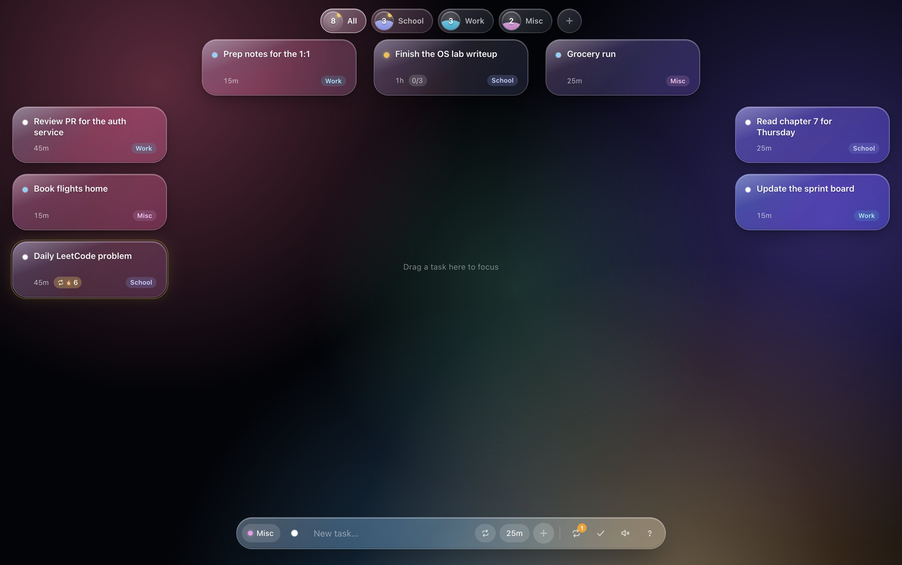
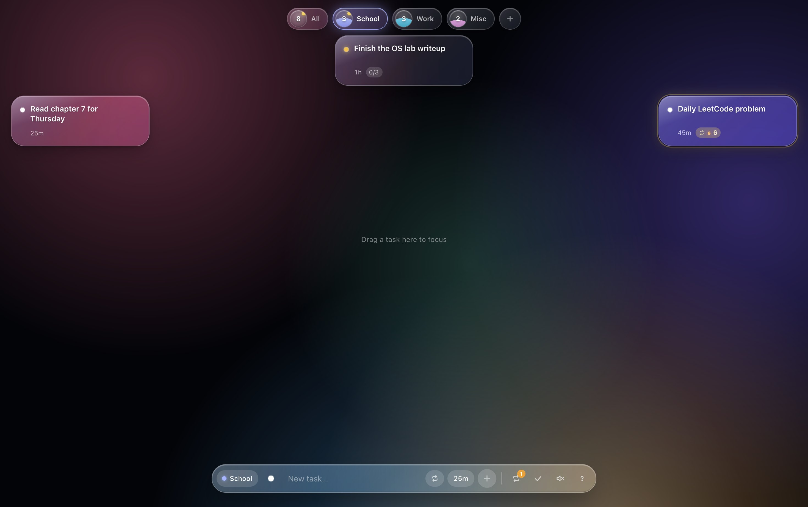
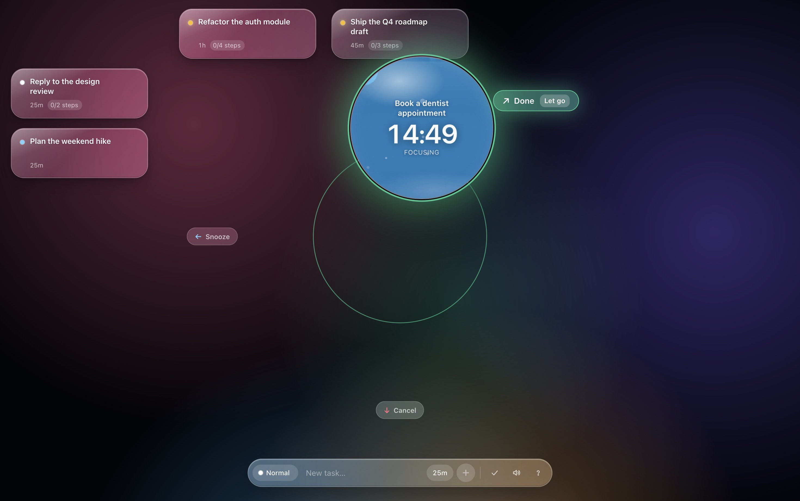
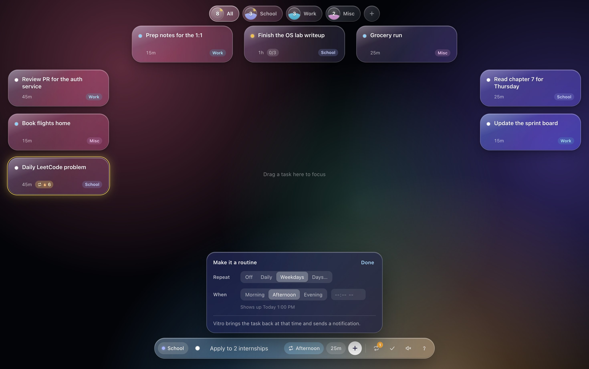
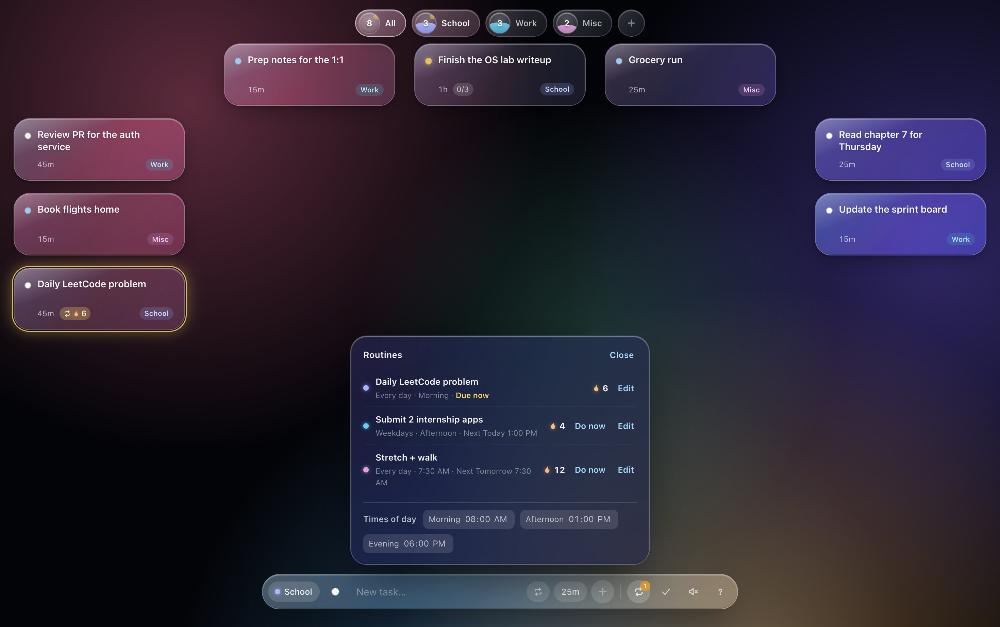

# Vitro

Liquid-glass task triage for the macOS menu bar. Tasks float on the edges of
the screen as glass cards, sorted into category bubbles. Drag one to the center
to focus it, then throw it to triage it. Routines like a daily LeetCode problem
come back on their own at the time you set.



> The screenshots are captured from the running app's own layer. In use, the
> dark areas are your desktop, blurred behind the overlay.

## Install

Open `release/mac-arm64/Vitro.app`, or drag it to `/Applications` first.
Vitro lives in the menu bar; there is no Dock icon. Right-click the menu-bar
icon for **Open at Login** and **Quit**.

## How it works

### Summon

Double-tap ⌥ Option, click the menu-bar icon, or press ⌃⌥Space. Cards cascade
in along the top, left and right edges and leave the center clear. Esc or a
click on the backdrop dismisses the overlay.

Cards never land on top of each other. New tasks skip any spot you've dragged a
card into. If the screen fills up completely, the extra cards stack as a tidy
deck marked "+N more"; opening a category shows fewer at a time.

### Categories

The bubbles along the top are your categories: School, Work and Misc to start.
Each one shows how many tasks are in it, with a little liquid level to match.

- **Click a bubble** to open it. Its tasks fan out around the screen and the
  rest tuck themselves into their bubbles. Click it again, or **All**, to see
  everything. Keys `0`–`8` switch too.
- **Drag a card onto a bubble** to file it there. The card shrinks as the bubble
  lights up.
- **+** adds a category (up to eight) with its own color. **Right-click** or
  double-click a bubble to rename, recolor or remove it. Removing one moves its
  tasks to Misc, and Undo brings it back.

New tasks go into whichever category is open, or the one shown on the left of
the dock.



### Focus

Drag a card toward the center. The focus zone lights up when you can let go.


On release the card morphs into the Focus Orb and its timer starts. The liquid
drains as time passes and shifts from cyan through green to amber. Click the
orb to pause or resume.


### Triage by throwing

Grab the orb and either flick it, or drag it past the ring until a label lights
up and let go. The labels show where each direction goes, and the orb glows in
the color of what will happen.



| Direction | Result |
| --- | --- |
| Up or right | Done |
| Straight down | Cancel |
| Left | Snooze back to the edge, progress kept |
| A small nudge | Springs back to center |

The buttons under the orb do the same things. Every done or cancel shows an
Undo toast, and the ✓ in the dock opens a log where you can restore tasks.

### Steps

A task's steps appear as a checklist under the orb while you focus it. Ticking
off the last one finishes the task with a small celebration.


Double-click a card to rename it.

### Routines

Some tasks come back: a LeetCode problem every evening, two internship
applications every weekday afternoon. Make any task a routine by tapping **↻**
in the dock before you add it, or by setting **Repeat** in its editor.



- **When**: every day, weekdays, or the days you pick, in the morning,
  afternoon or evening, or at an exact time. The parts of the day start at
  8:00 AM, 1:00 PM and 6:00 PM; change them at the bottom of the Routines panel.
- **When it's due**, the card appears on its own with an amber glow, macOS
  sends a notification, and the menu bar shows "1 due". Clicking the
  notification opens Vitro. If your Mac was asleep, you get one summary instead
  of a burst.
- **Finish it** like any task. It goes back to waiting for its next time and
  its streak (🔥) grows. Throwing it down **skips** this time instead.
- **Didn't get to it?** It stays on screen marked "Carried over", never
  duplicated, and the streak starts again.

The ↻ button in the dock lists every routine with its streak and next time.
**Do now** brings one out early, and it counts for its next occurrence.



### Edit a task

Hover a card and click ⋯ to set its title, category, priority, focus length,
repeat and up to six steps.
Priority is also weight: urgent tasks tilt less, glide farther and take longer
to settle.


### Add a task

Press `/` or `N`, type, and press Return. The dock also sets priority and
focus length for the new task.

## All gestures


## Good to know

- The menu bar shows the remaining time of the focused task, and a
  notification and bell fire when it runs out, even while the overlay is hidden.
- Tasks are saved to `~/Library/Application Support/Vitro/state.json`.
- The Claude desktop app also uses double-tap Option for Quick Entry by
  default. Change one of the two if they collide.

## Develop

```bash
npm install
npm run dev     # UI in a browser with a simulated desktop
npm test        # physics, layout, schedule and state tests
npm run app     # build and run the real overlay with Electron
npm run dist    # package release/mac-arm64/Vitro.app
npm run icons   # regenerate the tray and app icons
```

Set `VITRO_USER_DATA=/some/folder` when running from source to use a separate
profile and leave your real tasks alone.

## Layout

- `src/store.js`: tasks, categories, routines, timers, steps, undo, persistence
- `src/lib/physics.js`: spring tiers, mass per priority, throw classifier, release velocity
- `src/lib/geometry.js`: edge slots and the overlap-free card layout
- `src/lib/schedule.js`: when each routine is next due
- `src/components/Shelf.jsx`: category bubbles
- `src/components/RepeatPicker.jsx`: the repeat controls in the dock and editor
- `src/components/TaskBody.jsx`: card and Focus Orb as one persistent element
- `src/components/Liquid.jsx`: SVG gooey liquid timer
- `electron/`: menu-bar item, transparent overlay window, notifications
- `native/vitro-keyd.swift`: global double-tap Option detector, no permissions needed
