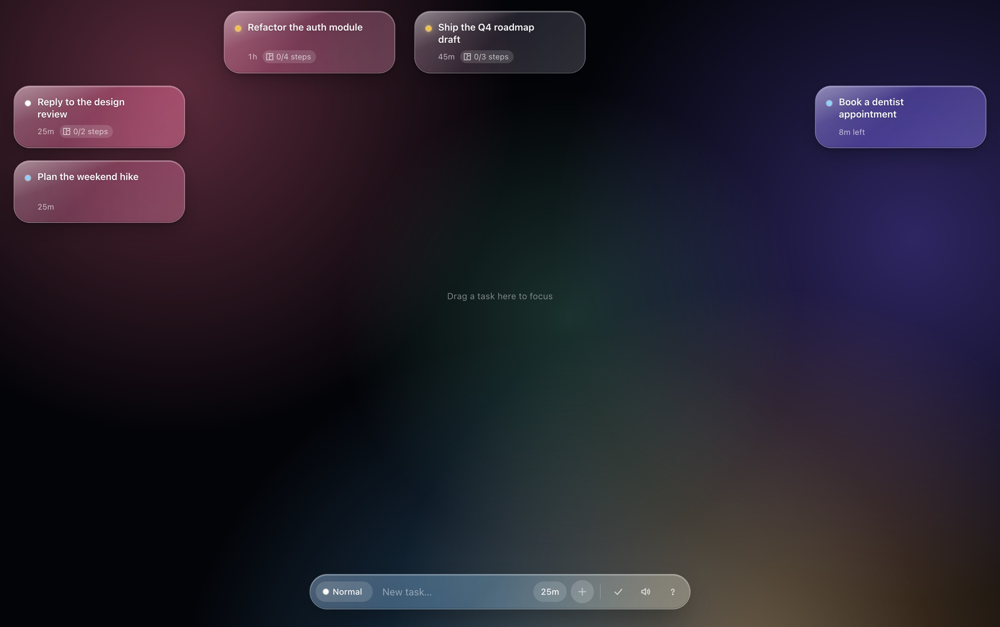
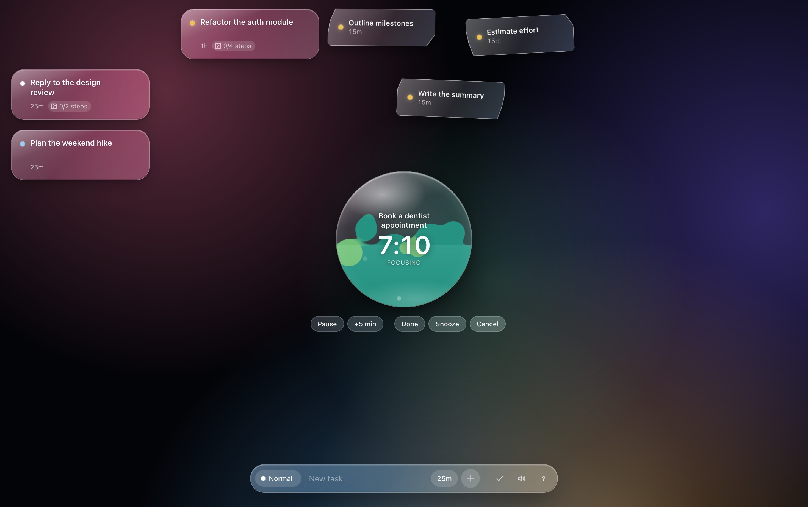
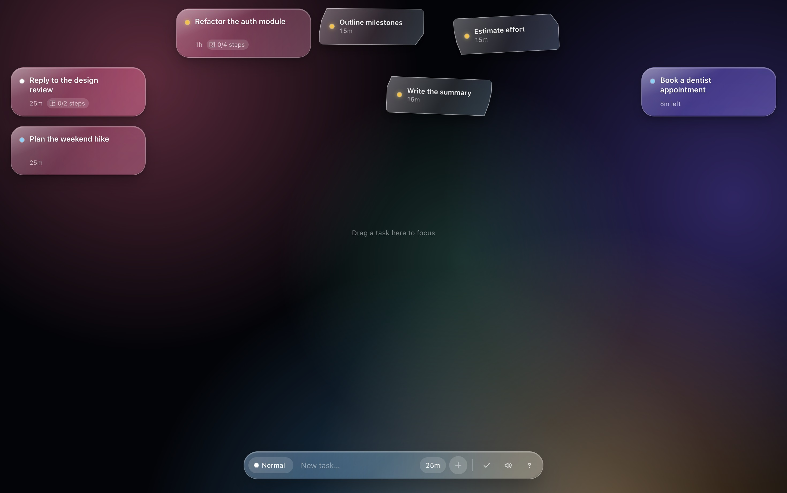

# Vitro

Liquid-glass task triage for the macOS menu bar. Tasks float on the edges of
the screen as glass cards. Drag one to the center to focus it, then throw it to
triage it.



> The screenshots are captured from the running app's own layer. In use, the
> dark areas are your desktop, blurred behind the overlay.

## Install

Open `release/mac-arm64/Vitro.app`, or drag it to `/Applications` first.
Vitro lives in the menu bar; there is no Dock icon. Right-click the menu-bar
icon for **Open at Login** and **Quit**.

## How it works

### Summon

Double-tap ⌥ Option, click the menu-bar icon, or press ⌃⌥Space. Cards cascade
in along the top, left and right edges and leave the center clear. Esc or a
click on the backdrop dismisses the overlay.

### Focus

Drag a card toward the center. The focus zone lights up when you can let go.


On release the card morphs into the Focus Orb and its timer starts. The liquid
drains as time passes and shifts from cyan through green to amber. Click the
orb to pause or resume.



### Triage by throwing

| Throw the orb | Result |
| --- | --- |
| Up or right | Done |
| Straight down | Cancel |
| Left | Snooze back to the edge, progress kept |
| Slower than 700 px/s | Springs back to center |

The buttons under the orb do the same things. Every done or cancel shows an
Undo toast, and the ✓ in the dock opens a log where you can restore tasks.

### Shatter into steps

⌥ Option-click a card that has 2–4 steps and it fractures into one shard per
step. Each shard is a task of its own: drag it to the center to focus it.



- Finish every shard and the parent completes on its own.
- Drop a shard next to a sibling to re-fuse them into the parent card.
- Double-click a card or shard to rename it.

### Edit a task

Hover a card and click ⋯ to set its title, priority, focus length and steps.
Priority is also weight: urgent tasks tilt less, glide farther and take longer
to settle.


### Add a task

Press `/` or `N`, type, and press Return. The dock also sets priority and
focus length for the new task.

## All gestures


## Good to know

- The menu bar shows the remaining time of the focused task, and a
  notification and bell fire when it runs out, even while the overlay is hidden.
- Tasks are saved to `~/Library/Application Support/Vitro/state.json`.
- The Claude desktop app also uses double-tap Option for Quick Entry by
  default. Change one of the two if they collide.

## Develop

```bash
npm install
npm run dev     # UI in a browser with a simulated desktop
npm test        # physics, geometry and state tests
npm run app     # build and run the real overlay with Electron
npm run dist    # package release/mac-arm64/Vitro.app
npm run icons   # regenerate the tray and app icons
```

Set `VITRO_USER_DATA=/some/folder` when running from source to use a separate
profile and leave your real tasks alone.

## Layout

- `src/store.js`: tasks, timers, shatter and re-fuse, undo, persistence
- `src/lib/physics.js`: spring tiers, mass per priority, throw classifier
- `src/lib/geometry.js`: edge slots, shatter polygons, shard placement
- `src/components/TaskBody.jsx`: card, shard and Focus Orb as one persistent element
- `src/components/Liquid.jsx`: SVG gooey liquid timer
- `electron/`: menu-bar item, transparent overlay window, notifications
- `native/vitro-keyd.swift`: global double-tap Option detector, no permissions needed
